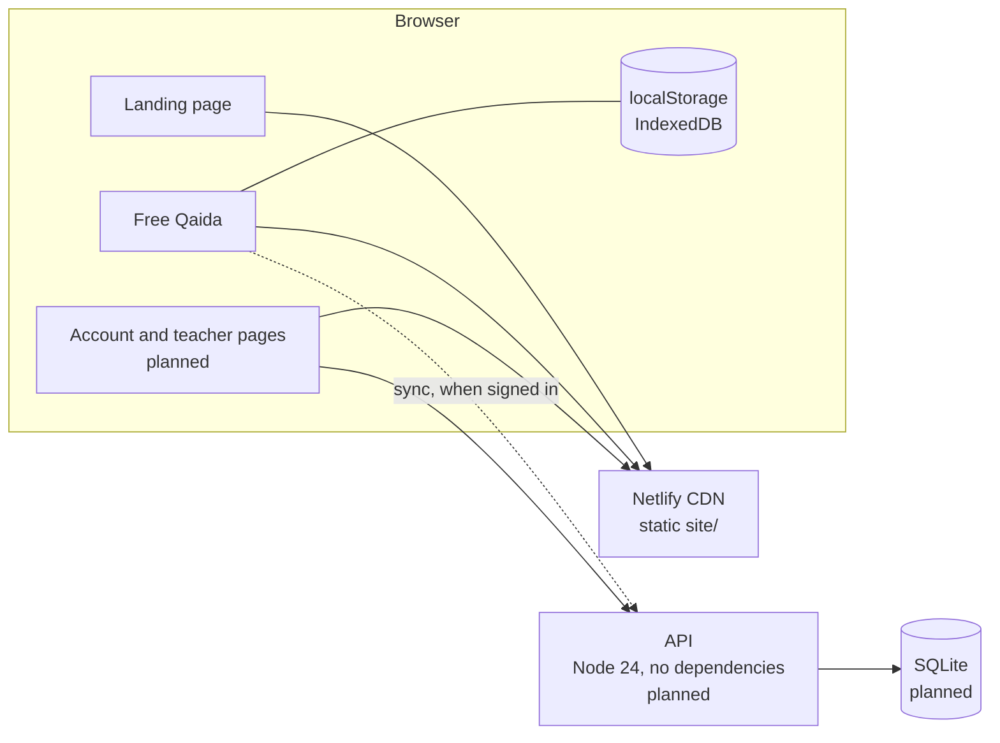

# Alif to Ayah

*Working name.* A website for learning to read the Qur'an, from the first letter to the first verse. It has three
parts:

- **A landing page.** As you scroll, a Qur'an opens (pre-rendered frames drawn to a canvas), and real verses appear on its
  pages, in both a dark and a light edition.
- **A free Qaida.** 29 lessons (23 built) that teach reading from zero, in the Madani or the Indo-Pak script, with
  tracing, "say it and listen back", the teacher's recordings as they are added, and a practice engine that keeps asking
  until each item is known. It works on any device, with no sign-up.
- **One-to-one lessons with a teacher.** Planned: accounts, progress synced across devices, and a dashboard for the
  teacher.

## Architecture at a glance



- **Local first.** The Qaida keeps progress on the device and never waits on a server. Accounts are optional.
- **Content is code.** Lessons and Qur'an text are versioned files. The text is copied from Quran.com by a script, never
  typed, and checked by hash.
- **No runtime dependencies.** Plain HTML, CSS and JavaScript in the browser, Node's own modules on the server.
- **Proved by scripts.** 25 check scripts run the real lesson code against the real pages in Node, with no browser.

The full design, with diagrams, the database schema, the API and the decision records, is in
[docs/architecture/README.md](docs/architecture/README.md).

## Repository layout

```text
site/                 the website, served as-is
  index.html          the landing page (main.js, atmosphere.js, footer.js)
  qaida/              the free Qaida: lesson pages, page scripts, data layers, the practice engine
tools/                fetch scripts that copy Qur'an text, and the check scripts
docs/                 the Obsidian vault's notes: architecture, one folder per lesson, the voice feature
design-system/        colours, type, spacing and the page designs
videos/               the hero footage and the scripts that prepared its frames
WEBSITE-BUILD.md      how the landing page was built, phase by phase
QAIDA-BUILD.md        how the Qaida is being built, step by step
QAIDA-CONTENT.md      what the Qaida teaches
MAP.md                the hub note for Obsidian's graph view
serve.js              a zero-dependency local preview server
```

## Run it

Node 24 is the only requirement. There is nothing to install.

```bash
node serve.js
```

Then open <http://localhost:8777/site/>. To try it on a phone on the same wifi, run `node serve.js --phone` and open
the address it prints.

## Check it

Each check prints what it covered and exits non-zero on a failure:

```bash
node tools/qaida-check.js
```

| Checks | Covers |
|---|---|
| `tools/qaida-check.js` | The practice engine and its storage |
| `tools/qaida-*-check.js` | One script per lesson page, the rule and verse pages, the words, and the voice recorder (25 in all) |
| `tools/scroll-sim/checks.js` | The landing page's scrolling, in a simulated page |

One command for all of them, `node tools/check-all.js`, arrives in phase A of the [roadmap](docs/architecture/10-roadmap.md).

## Documentation

The repository is an [Obsidian](https://obsidian.md) vault. Open the folder as a vault and start at [MAP.md](MAP.md).
Graph view (Ctrl+G) shows how every note connects, and `docs/architecture/architecture.canvas` is the system as a board.

| Start here | For |
|---|---|
| [docs/architecture/README.md](docs/architecture/README.md) | How the whole system is built |
| [docs/architecture/decisions/README.md](docs/architecture/decisions/README.md) | Why each big choice was made |
| [docs/architecture/10-roadmap.md](docs/architecture/10-roadmap.md) | What gets built next |
| [QAIDA-BUILD.md](QAIDA-BUILD.md) | The Qaida's build log |
| [WEBSITE-BUILD.md](WEBSITE-BUILD.md) | The landing page's build log |

## Content sources

- Qur'an text: copied word for word from the [Quran.com API](https://api.quran.com) (`text_uthmani` and
  `text_indopak`) by `tools/fetch-qaida-words.js` and `tools/fetch-qaida-verses.js`.
- The English meanings on the landing page: Saheeh International, through the same API. Its licence is to be confirmed
  before launch.
- Recordings: the teacher's own voice or a vetted reciter, never a generated voice.
