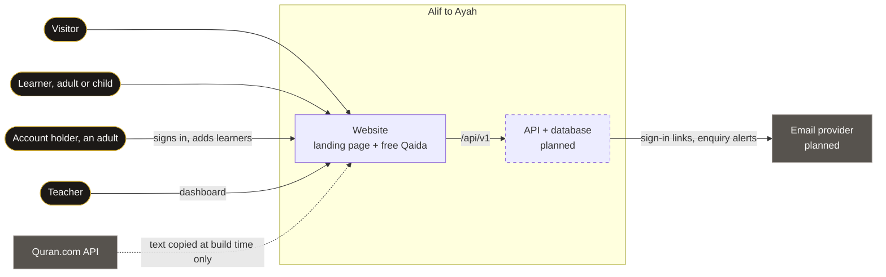
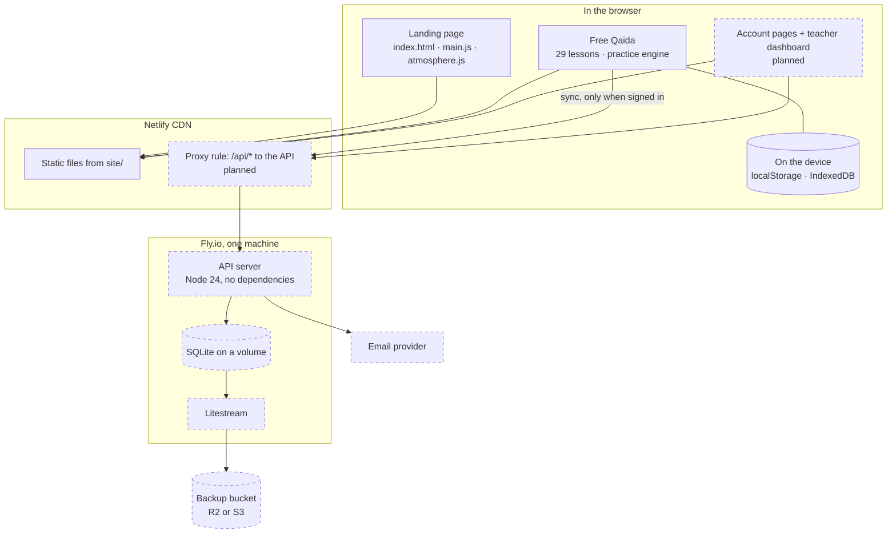

# 1. System overview

**Part of** [[docs/architecture/README|Architecture]] · [[MAP]]

**In one paragraph.** The site is static files served from a CDN: plain HTML, CSS and JavaScript, no framework. The free
Qaida keeps a student's progress on their own device and needs nothing else to work. A small API server, with a SQLite
database, gets added beside it for three jobs only: taking enquiries, letting an account carry progress across devices,
and giving the teacher a dashboard of their students. Lessons, words and verses are not in the database. They stay
as versioned, checked files ([[docs/architecture/decisions/0002-content-as-code|ADR-0002]]).

## Who uses it

| Person | What they do | Needs an account? |
|---|---|---|
| **Visitor** | Sees the landing page, opens the free Qaida, sends an enquiry | No |
| **Learner** | Works through Qaida lessons, any age | No. A profile under an adult's account, if they want sync |
| **Account holder** | An adult (a parent, or an adult learner). Signs in, adds learner profiles, shares one with the teacher | Yes |
| **Teacher** | Reads enquiries, sees enrolled students' progress and the items they struggle with | Yes, role `teacher` |

## Context: the system and what it talks to

Quran.com is only ever contacted by the tools that copy text into the repo (`tools/fetch-qaida-words.js`,
`tools/fetch-qaida-verses.js`). A visitor's browser never calls it, so the site's Qur'an text can't change under it.

## Containers: what runs where

Dashed boxes are planned. Because Netlify forwards `/api/*` to the API, the browser sees **one origin**: no CORS, and
the sign-in cookie is an ordinary first-party cookie ([[docs/architecture/decisions/0009-hosting|ADR-0009]]).

## The rules the system follows

1. **Local first.** The Qaida works with no network and no account. The server only adds to it; if the server is down,
   no lesson stops working. ([[docs/architecture/decisions/0003-local-first|ADR-0003]])
2. **Content is code.** Lessons, items, words and verses live in files under `site/qaida/`, reviewed in git and
   proved by check scripts. The database holds people's data and points at content by id.
   ([[docs/architecture/decisions/0002-content-as-code|ADR-0002]])
3. **Qur'an text is copied, never typed.** Tools fetch it from Quran.com, unmodified, and the checks recompute its
   hashes. (The rule from [[WEBSITE-BUILD]] §4, applied to the Qaida in [[QAIDA-BUILD]].)
4. **No runtime dependencies.** The server uses Node's own modules only, so there is nothing to `npm install` and no
   supply chain to trust. ([[docs/architecture/decisions/0004-node-zero-dependency-api|ADR-0004]])
5. **One box, one file.** One server process and one SQLite database: a modular monolith, split inside by feature.
   ([[docs/architecture/decisions/0005-sqlite|ADR-0005]])
6. **Collect the least.** Adults hold accounts, children are profiles with a display name, and a child's voice stays on
   the device unless you decide otherwise. ([[docs/architecture/decisions/0008-adults-hold-accounts|ADR-0008]],
   [[docs/architecture/decisions/0011-voice-to-teacher-gated|ADR-0011]])
7. **Accessible by default.** WCAG 2.2 AA: keyboard, screen readers, reduced motion, 44px touch targets, 4.5:1 contrast
   ([[design-system/quran-landing/MASTER|MASTER]]).
8. **If a rule matters, a script proves it.** 25 check scripts run today; every backend rule gets a test too
   ([[docs/architecture/09-testing|Testing]]).

## Quality targets

| Quality | Target | How it's met |
|---|---|---|
| Speed | Landing page LCP under 2.5 s on 4G; a Qaida page under 320 KB of script (297 KB today at most) | Static files on a CDN, WebP frames, no framework ([[docs/architecture/02-frontend#Budgets|budgets]]) |
| Works offline | Every built lesson works with no connection once loaded | Local-first; a service worker later makes it installable ([[docs/architecture/10-roadmap|roadmap]], later ideas) |
| Availability | The Qaida: as available as the CDN. The API: 99.5% is plenty | The API is never on a lesson's critical path |
| Privacy | No trackers, no third-party scripts, nothing about a child beyond a display name | [[docs/architecture/07-security-and-privacy|Security and privacy]] |
| Recoverability | Lose at most a few seconds of data; restore within an hour | Litestream streams the database to a bucket ([[docs/architecture/08-deployment-and-operations|operations]]) |
| Cost | Under $10 a month at launch | Free CDN tier, one small machine |

## What it is not, on purpose

No microservices, no Kubernetes, no single-page-app framework, no GraphQL. The audience is one teacher, tens of
one-to-one students and perhaps thousands of free Qaida users. One small machine with SQLite serves that many times over,
and every extra moving part would be something to keep running, secure and pay for. The architecture is built so it
**can** grow (the SQL stays close to portable, the modules have clean edges) without paying for growth before it comes.
