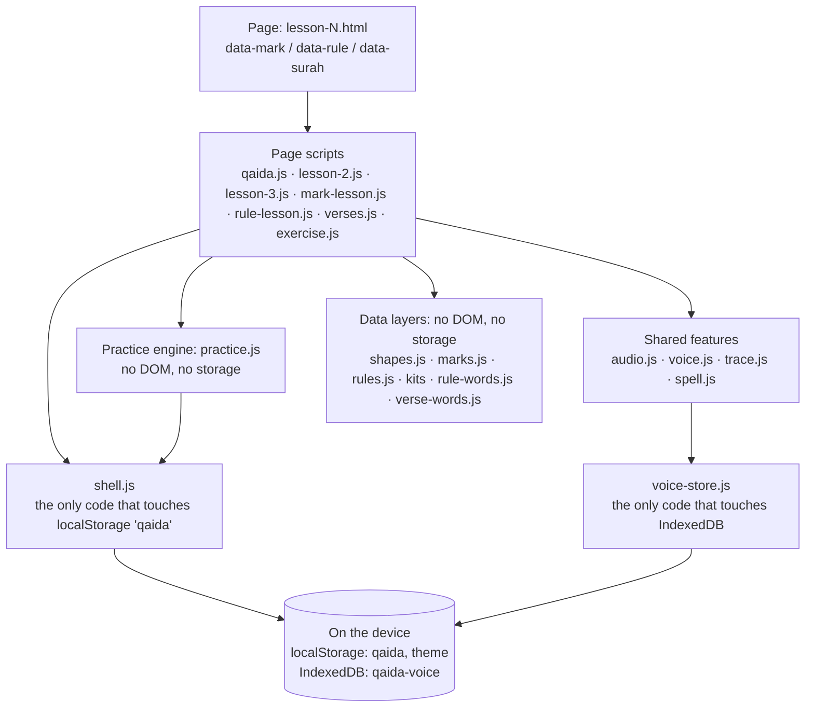

# 2. Frontend

**Part of** [[docs/architecture/README|Architecture]] · built by [[WEBSITE-BUILD]] (landing page) and [[QAIDA-BUILD]] (Qaida)

**In one paragraph.** Every page is a plain HTML file that loads a few scripts in a fixed order. There is no framework
and no build step ([[docs/architecture/decisions/0001-static-frontend|ADR-0001]]). Each script wraps itself in a
function and shares only what it must, through a handful of `window.*` names. The code keeps three strict layers:
**data** (no DOM, no storage), **engine** (no DOM, no storage) and **pages** (everything visible). That split is why 25
check scripts can run the real code in Node with no browser.

## The pages

| Area | Files | Status |
|---|---|---|
| Landing page | `site/index.html` · `main.js` (hero canvas, scroll, theme) · `atmosphere.js` (dust, light, pattern) · `footer.js` (form) | Built |
| Qaida home | `site/qaida/index.html` · `shell.js` · `home.js` | Built |
| Lessons 1–23 | `site/qaida/lesson-N.html` (23 pages) | Built; 24–29 planned ([[MAP]]) |
| Exercises 4–22 | `site/qaida/exercise-N.html` (19 pages) · `exercise.js` | Built |
| Recordings list | `site/qaida/recordings.html` · `recordings.js` (a teacher's tool: which clips are missing) | Built |
| Contact page | `site/contact/` (the email form, moved off the landing page as decided in [[WEBSITE-BUILD]] §7, phase 5) | Planned, phase C |
| Account | `site/account/` (sign in, learners, export, delete) | Planned, phase D |
| Teacher dashboard | `site/teach/` (enquiries, students, progress) | Planned, phase F |
| Privacy | `site/privacy/` | Planned, phase G |

## The Qaida's page types

A lesson page says what it teaches with one attribute on `<html>`, and one page script draws every lesson of its type.

| Page type | Lessons | Page script | Data it reads |
|---|---|---|---|
| Letters | 1 | `qaida.js` | the letters in `shell.js` |
| Drill | 2 | `lesson-2.js` | the letters, shuffled |
| Shapes | 3 | `lesson-3.js` | `shapes.js` |
| Mark (`data-mark`) | 4–15 | `mark-lesson.js` + `spell.js` | `marks.js` |
| Rule (`data-rule`) | 16–22 | `rule-lesson.js` + `spell.js` | `rules.js`, a **kit** per lesson (`ends.js`, `al.js`, `wasl.js`, `madd.js`, `silent.js`, `stop.js`), `rule-words.js` |
| Verse (`data-surah`) | 23, later 29 | `verses.js` | `fatiha.js` (the kit), `verse-words.js` |
| Exercise | 4–22 | `exercise.js` | `marks.js` |

Drill pages (2–22) all ask their questions through one engine, `practice.js`
([[docs/lesson-2/02-practice-engine|its specification]]).

## The layers

**Rules that keep it testable** (each is checked by a script, [[docs/architecture/09-testing|Testing]]):

- A data layer has no DOM and no storage. It is loaded by Node as-is.
- `practice.js` never touches the DOM or storage. A page asks it for a question and reports the answer; progress goes
  through `qaidaShell`.
- `shell.js` is the **one seam** to stored progress. Everything that changes progress goes through four of its
  functions: `recordAnswer`, `markSeen`, `setDone`, and the two resets (`clearLesson`, `clearDrill`). That seam is where
  sync plugs in later, without touching any lesson ([[docs/architecture/06-sync|Progress sync]]).
- Qur'an words are never typed into a kit. A kit names a word by reference (`"1:2:1"`), and the page draws it from
  `rule-words.js` / `verse-words.js`, which only the fetch tools write.

## The shared names

| Name | Set by | What it is |
|---|---|---|
| `window.qaidaShell` | `shell.js` | State, letters, lessons, progress functions, the setup and theme |
| `window.qaidaAudio` | `audio.js` | Plays the teacher's recordings listed in `audio/manifest.json` |
| `window.qaidaVoiceStore` | `voice-store.js` | The student's own recordings, in IndexedDB |
| `window.qaidaRuleWords` | `rule-words.js` | Qur'an words copied from Quran.com, both scripts |
| `window.qaidaVerseWords` | `verse-words.js` | Whole verses copied from Quran.com, both scripts |

## What is kept on the device

| Where | Key | What | Written by |
|---|---|---|---|
| localStorage | `qaida` | Script, names, grouping, and per lesson: letters seen, done, and the drill's right, wrong and streak per item | `shell.js` only |
| localStorage | `theme` | `light` or `dark` | `shell.js`, `main.js` |
| IndexedDB | `qaida-voice` → `clips` | The student's own recordings, at most 200 clips and 25 MB, oldest dropped first | `voice-store.js` only |
| localStorage | `qaida:outbox` | **Planned:** events waiting to sync, only once an adult has linked the device to a learner | `shell.js` |

Everything read back from storage is checked and capped before use (`shell.js` `read()`), because an old version of the
page, another script or a damaged profile may have written it. The server does the same with what the browser sends.

## The landing page

`main.js` draws pre-rendered frames of the Qur'an opening onto a `<canvas>` by scroll position (87 dark frames and 63
light ones, WebP by default and PNG with `?png`). It also owns the wheel glide, the half-open auto-finish, the lock-in
between sections and the theme switch. `atmosphere.js` draws the air around the book on up to three canvases and erases
the book's own area every frame, so nothing is ever drawn over the Qur'an. The full spec and every tuning decision are in
[[WEBSITE-BUILD]] §2–§7. Its scroll behaviour is tested in a simulated page (`tools/scroll-sim/`).

## The tryout layer: preview only, deleted before launch

These files exist so you can try options on the page. None of them ships:

`wordmark-options.js` · `top-options.js` · `ending-options.js` · `footer-options.js` · `scroll-check.js` ·
`qaida/qaida-options.js`, and the `TRYOUT` sections of `styles.css` and `qaida.css`.

Each one's header says what to do when the choice is made: write the chosen value into the HTML or CSS, then delete
the file and its `<script>` tag. Removing them is phase I in the [[docs/architecture/10-roadmap|roadmap]].

## What the backend adds to the frontend

Same stack, same rules, no framework:

- `site/shared/api.js`: one small wrapper around `fetch`. It sends and reads JSON, turns problem+json errors into
  readable messages, times out after 10 s, and never retries a request that changes data unless it is idempotent.
- `site/qaida/sync.js`: sends the outbox and merges progress back ([[docs/architecture/06-sync|Progress sync]]).
- The account, contact, teacher and privacy pages above.

The teacher dashboard is the one place a framework might be tempting. It is a few tables and a heatmap, so it stays
plain too ([[docs/architecture/decisions/0001-static-frontend|ADR-0001]] says when to revisit).

## Budgets

| Budget | Limit |
|---|---|
| Script on a Qaida page | 320 KB uncompressed, not counting the tryout files. Measured 2026-10-08: the rule pages are the biggest, Lesson 22 at 297 KB, so they are close to the line. Compression on the CDN sends roughly a quarter of that |
| Landing page hero | Both WebP frame sets together are about 2.3 MB; the frame on screen is fetched before the rest |
| Outside requests | None. Since 2026-10-08 the fonts are copied into `site/fonts/` (`tools/self-host-fonts.js`), and the CSP in `site/_headers` (`default-src 'self'`) enforces it |
| Touch targets | 44 px, measured at 375 px wide |
