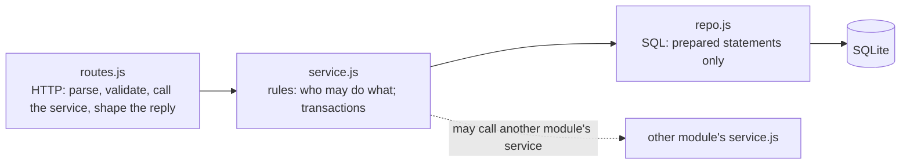
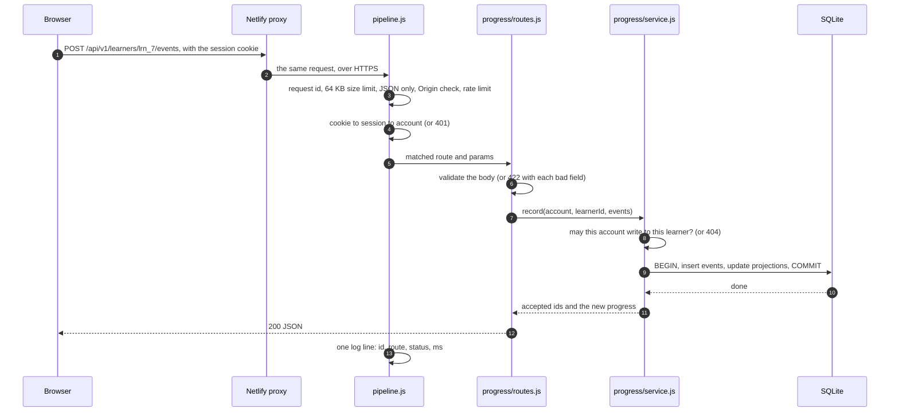

# 3. Backend

**Part of** [[docs/architecture/README|Architecture]] · data in [[docs/architecture/04-data-model|Data model]] ·
endpoints in [[docs/architecture/05-api|API]]

**In one paragraph.** One Node 24 process, built only from Node's own modules (`node:http`, `node:sqlite`,
`node:crypto`, `node:test`, and the built-in `fetch`), so there is nothing to `npm install`
([[docs/architecture/decisions/0004-node-zero-dependency-api|ADR-0004]]). It is a **modular monolith**: one program to
deploy, split inside into feature modules with clear edges. It is not built yet; phase B of the
[[docs/architecture/10-roadmap|roadmap]] builds the skeleton.

## Why there is a backend at all

The Qaida doesn't need one, and the backend must never become something a lesson waits on
([[docs/architecture/decisions/0003-local-first|ADR-0003]]). It exists for three jobs that can't be done on a device:

1. **Take enquiries.** The contact form has nowhere to send yet ([[docs/architecture/decisions/0010-own-enquiry-endpoint|ADR-0010]]).
2. **Carry progress across devices.** An account holder's learners keep their progress on a phone and a laptop.
3. **Let the teacher see their students.** Which lessons are done, and which letters or rules each student keeps
   getting wrong, between one-to-one lessons.

What the backend does **not** do: serve lessons (the CDN does), store Qur'an text or lesson content (files do), or
receive voice recordings (not unless [[docs/architecture/decisions/0011-voice-to-teacher-gated|ADR-0011]] is accepted).

## Folder layout

```text
server/
  package.json          {"type": "module"}, scripts only. No dependencies, ever (a check fails if one appears)
  main.js               reads config, opens the database, runs migrations, starts HTTP, stops cleanly on SIGTERM
  config.js             every environment variable, checked at start: a missing one stops the server with a clear message
  http/
    router.js           method + path patterns with :params, about 60 lines
    pipeline.js         request id, security headers, size limit, JSON parsing, cookies, Origin check, rate limit, access log
    problem.js          errors as RFC 9457 problem+json
    validate.js         small schema checks: types, lengths, enums, the same caps shell.js uses
  db/
    database.js         the only file that imports node:sqlite. WAL, foreign keys, busy timeout, a transaction helper
    migrate.js          applies migrations/NNNN_*.sql in order, records the number in PRAGMA user_version
    migrations/0001_init.sql
  modules/
    auth/               routes.js · service.js · repo.js   sign-in links, sessions, /me
    learners/           routes.js · service.js · repo.js   profiles under an account
    progress/           routes.js · service.js · repo.js · project.js   events in, projections out
    enquiries/          routes.js · service.js · repo.js
    teach/              routes.js · service.js · repo.js   invites, enrolments, the dashboard's reads
    privacy/            routes.js · service.js             export and erase
  mail/
    mailer.js           send({ to, subject, text }) with two adapters: console (dev, tests) and an HTTPS provider
  jobs.js               hourly and daily clean-ups, in-process timers: no queue needed at this size
  test/                 node:test files, one per module, plus helpers that start a real server on a free port
```

## Layers inside a module



- **Routes** know HTTP and nothing about SQL. They turn a request into plain values and a result into JSON.
- **Services** hold the rules: may this account read this learner, what happens in one transaction. They are where
  most tests aim, because they take plain values.
- **Repositories** are the only place SQL is written, always as prepared statements with `?` placeholders. A check fails
  the build if a template string is ever passed to `prepare(`.
- A module may call another module's **service**, never its repository, so each table has one owner.

## One request, start to finish



A learner that exists but belongs to someone else gets **404, not 403**, so ids can't be probed.

## Configuration

Read once at start by `config.js`. Secrets come from the host's secret store, never from a file in git.

| Variable | Example | Meaning |
|---|---|---|
| `PORT` | `8080` | Where the server listens |
| `DATABASE_PATH` | `/data/app.db` | The SQLite file, on the persistent volume |
| `PUBLIC_ORIGIN` | `https://alif-to-ayah.example` | The one origin allowed to send changing requests, and the base of sign-in links |
| `TEACHER_EMAIL` | (secret) | Gets enquiry alerts; the first account with this email becomes the teacher |
| `MAIL_PROVIDER` | `console` or `resend` | `console` prints mail to the log, for local use and tests |
| `MAIL_API_KEY` | (secret) | Only when the provider isn't `console` |
| `MAIL_FROM` | `lessons@…` | The sending address (SPF and DKIM set up at launch) |
| `LOG_LEVEL` | `info` | `debug` locally |

Locally, `node server/main.js --dev` also serves `site/`, so the API and the pages share one origin, exactly as in
production. `serve.js` stays as it is for previewing the static site alone.

## Errors

Every error is `application/problem+json` ([RFC 9457](https://www.rfc-editor.org/rfc/rfc9457)) with the request's id,
so a student's "it said error 7f3a…" can be found in the logs. Unexpected errors log the stack and reply with a plain
500. A stack trace never reaches the browser. See [[docs/architecture/05-api#Errors|API errors]].

## Background jobs

In-process timers, because there is one process:

| Every | Job |
|---|---|
| hour | Delete sign-in tokens used or expired more than a day ago, and expired sessions |
| day | Delete enquiries closed more than 12 months ago, and audit events older than 12 months |
| day | `PRAGMA optimize` |

Backups are not a job here: Litestream streams the database continuously
([[docs/architecture/08-deployment-and-operations|operations]]).

## Starting and stopping

On start: check config, open the database, apply migrations in a transaction (a failed migration stops the start), then
listen. On `SIGTERM`, which the host sends before a deploy: stop taking new requests, finish the ones in flight (up to
10 s), close the database. A deploy never cuts a write in half.

## Gotchas, written down before they bite

- **`INSERT OR IGNORE` hides bad data.** In SQLite it skips rows that break a `CHECK` too, without an error. Duplicate
  events are skipped with `INSERT … ON CONFLICT (id) DO NOTHING` instead, which only skips true duplicates. Found while
  testing the schema on 2026-10-08 ([[docs/architecture/04-data-model|Data model]]).
- **One writer.** SQLite on a volume means exactly one API machine. Never scale it to two
  ([[docs/architecture/decisions/0005-sqlite|ADR-0005]]).
- **`node:sqlite` is still marked as in active development** in Node 24. Only `db/database.js` imports it, so moving to
  another SQLite driver touches one file.
