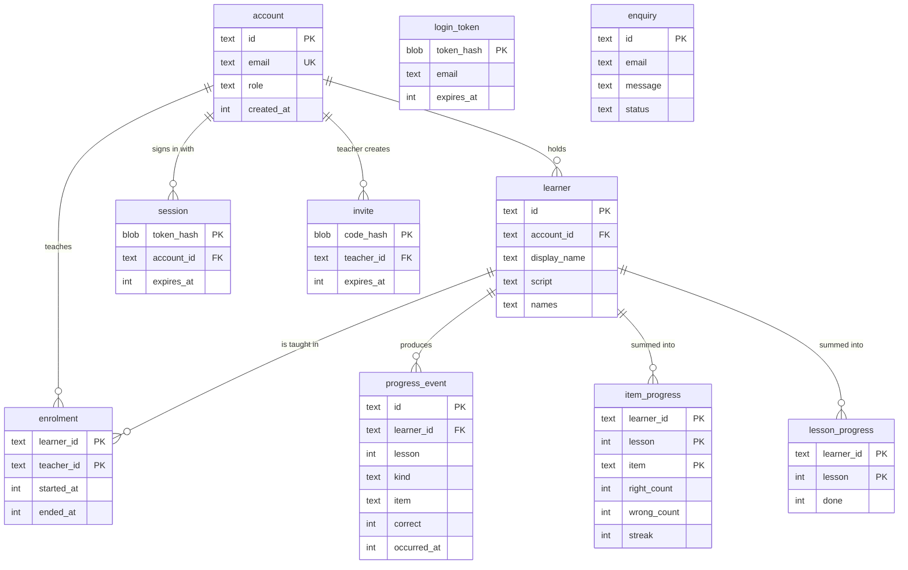

# 4. Data model

**Part of** [[docs/architecture/README|Architecture]] · owned by the modules in [[docs/architecture/03-backend|Backend]] ·
fed by [[docs/architecture/06-sync|Progress sync]]

**In one paragraph.** One SQLite file ([[docs/architecture/decisions/0005-sqlite|ADR-0005]]). It holds **people's data
only**: accounts, learners, their progress, enquiries. Lessons, items, words and verses stay in files
([[docs/architecture/decisions/0002-content-as-code|ADR-0002]]), and the database points at them by id: a **lesson
number** (1–29, as in `shell.js`'s `LESSONS`) and an **item id** (the same 1–24 character id `shell.js` stores today).

## The tables



| Table | One row is | Owner module |
|---|---|---|
| `account` | An adult who signs in, or the teacher | auth |
| `learner` | A person learning, under an account ([[docs/architecture/decisions/0008-adults-hold-accounts|ADR-0008]]) | learners |
| `session` | A signed-in browser | auth |
| `login_token` | An emailed sign-in link, until it is used or expires | auth |
| `progress_event` | One thing that happened in a lesson: an answer, a letter seen, a lesson done | progress |
| `item_progress` | A learner's running totals for one item, summed from the events | progress |
| `lesson_progress` | Whether a learner has finished a lesson | progress |
| `invite` | A short code the teacher gives a family to share one learner | teach |
| `enrolment` | "This teacher may see this learner" | teach |
| `enquiry` | A message from the contact form | enquiries |
| `audit_event` | Who exported, deleted or shared what, with no personal details | privacy |

## The first migration

This is `server/db/migrations/0001_init.sql` as it will be written in phase B. It has **already been run**: on
2026-10-08 it was applied to an in-memory database with Node 24's own SQLite (3.53), and 20 tests of its constraints
passed (unique emails in any case, checked enums, lesson 1–29 only, item ids up to 24 characters, a baseline must carry
valid JSON, deleting an account deletes everything under it).

```sql
-- 0001_init.sql: the first schema. Applied once, in a transaction, by db/migrate.js; PRAGMA user_version records it.
-- Ids are random text ('acc_…', 'lrn_…'), never counters: nothing to guess in a URL, and the browser can make its own
-- (progress events). Times are Unix milliseconds. Every table is STRICT, so a wrong type is an error, not a surprise.

CREATE TABLE account (
  id           TEXT PRIMARY KEY,
  email        TEXT NOT NULL UNIQUE COLLATE NOCASE CHECK (length(email) BETWEEN 3 AND 254),
  role         TEXT NOT NULL DEFAULT 'member' CHECK (role IN ('member', 'teacher')),
  created_at   INTEGER NOT NULL,
  last_seen_at INTEGER
) STRICT;

-- A person learning. An adult learning alone has one, for themselves; a parent has one per child (ADR-0008).
-- A display name (a nickname is fine) and the two choices the Qaida asks for. No age, no photo, no school.
CREATE TABLE learner (
  id           TEXT PRIMARY KEY,
  account_id   TEXT NOT NULL REFERENCES account(id) ON DELETE CASCADE,
  display_name TEXT NOT NULL CHECK (length(display_name) BETWEEN 1 AND 40),
  script       TEXT NOT NULL DEFAULT 'madani' CHECK (script IN ('madani', 'indopak')),
  names        TEXT NOT NULL DEFAULT 'fatha' CHECK (names IN ('fatha', 'zabar')),
  created_at   INTEGER NOT NULL
) STRICT;
CREATE INDEX learner_by_account ON learner (account_id);

-- Only the SHA-256 of a cookie or an emailed token is kept: a copy of this database signs nobody in.
CREATE TABLE session (
  token_hash   BLOB PRIMARY KEY,
  account_id   TEXT NOT NULL REFERENCES account(id) ON DELETE CASCADE,
  created_at   INTEGER NOT NULL,
  expires_at   INTEGER NOT NULL
) STRICT;
CREATE INDEX session_by_account ON session (account_id);

CREATE TABLE login_token (
  token_hash   BLOB PRIMARY KEY,
  email        TEXT NOT NULL COLLATE NOCASE,
  expires_at   INTEGER NOT NULL,
  used_at      INTEGER
) STRICT;

-- What happened on the device, append-only (ADR-0006, docs/architecture/06-sync.md). The id is made by the browser, so
-- sending the same event twice changes nothing: insert with ON CONFLICT (id) DO NOTHING. Never INSERT OR IGNORE, which
-- also drops a row that breaks a CHECK, silently. `lesson` and `item` name content that lives in files
-- (ADR-0002): a lesson number from shell.js's LESSONS, an item id as shell.js already stores it (1 to 24 characters).
CREATE TABLE progress_event (
  id           TEXT PRIMARY KEY CHECK (length(id) BETWEEN 8 AND 64),
  learner_id   TEXT NOT NULL REFERENCES learner(id) ON DELETE CASCADE,
  lesson       INTEGER NOT NULL CHECK (lesson BETWEEN 1 AND 29),
  kind         TEXT NOT NULL CHECK (kind IN ('answer', 'seen', 'done', 'undone', 'reset', 'baseline')),
  item         TEXT CHECK (item IS NULL OR length(item) BETWEEN 1 AND 24),
  correct      INTEGER CHECK (correct IS NULL OR correct IN (0, 1)),
  data         TEXT CHECK (data IS NULL OR json_valid(data)),
  occurred_at  INTEGER NOT NULL,
  received_at  INTEGER NOT NULL,
  CHECK ((kind = 'answer') = (correct IS NOT NULL)),
  CHECK (kind NOT IN ('answer', 'seen', 'baseline') OR item IS NOT NULL),
  CHECK ((kind = 'baseline') = (data IS NOT NULL))
) STRICT;
CREATE INDEX progress_event_by_item ON progress_event (learner_id, lesson, item, occurred_at);

-- Projections: rebuilt from progress_event at any time, kept up to date in the same transaction as each insert.
CREATE TABLE item_progress (
  learner_id   TEXT NOT NULL REFERENCES learner(id) ON DELETE CASCADE,
  lesson       INTEGER NOT NULL,
  item         TEXT NOT NULL,
  seen         INTEGER NOT NULL DEFAULT 0 CHECK (seen IN (0, 1)),
  right_count  INTEGER NOT NULL DEFAULT 0 CHECK (right_count >= 0),
  wrong_count  INTEGER NOT NULL DEFAULT 0 CHECK (wrong_count >= 0),
  streak       INTEGER NOT NULL DEFAULT 0 CHECK (streak >= 0),
  last_at      INTEGER NOT NULL,
  PRIMARY KEY (learner_id, lesson, item)
) STRICT, WITHOUT ROWID;

CREATE TABLE lesson_progress (
  learner_id   TEXT NOT NULL REFERENCES learner(id) ON DELETE CASCADE,
  lesson       INTEGER NOT NULL,
  done         INTEGER NOT NULL DEFAULT 0 CHECK (done IN (0, 1)),
  updated_at   INTEGER NOT NULL,
  PRIMARY KEY (learner_id, lesson)
) STRICT, WITHOUT ROWID;

-- The teacher reads a short code out in a lesson; the parent types it in to share one learner's progress.
CREATE TABLE invite (
  code_hash    BLOB PRIMARY KEY,
  teacher_id   TEXT NOT NULL REFERENCES account(id) ON DELETE CASCADE,
  note         TEXT CHECK (note IS NULL OR length(note) <= 80),
  expires_at   INTEGER NOT NULL,
  used_at      INTEGER
) STRICT;

-- Which learners a teacher may see. Every teacher query joins through here (07-security-and-privacy.md).
CREATE TABLE enrolment (
  learner_id   TEXT NOT NULL REFERENCES learner(id) ON DELETE CASCADE,
  teacher_id   TEXT NOT NULL REFERENCES account(id) ON DELETE CASCADE,
  started_at   INTEGER NOT NULL,
  ended_at     INTEGER,
  PRIMARY KEY (learner_id, teacher_id)
) STRICT;
CREATE INDEX enrolment_by_teacher ON enrolment (teacher_id, ended_at);

-- The contact form (ADR-0010). Deleted 12 months after it is closed.
CREATE TABLE enquiry (
  id           TEXT PRIMARY KEY,
  name         TEXT NOT NULL CHECK (length(name) BETWEEN 1 AND 80),
  email        TEXT NOT NULL CHECK (length(email) BETWEEN 3 AND 254),
  for_whom     TEXT CHECK (for_whom IS NULL OR for_whom IN ('me', 'my-child', 'someone-else')),
  level        TEXT CHECK (level IS NULL OR length(level) <= 80),
  timezone     TEXT CHECK (timezone IS NULL OR length(timezone) <= 64),
  message      TEXT NOT NULL CHECK (length(message) BETWEEN 1 AND 4000),
  status       TEXT NOT NULL DEFAULT 'new' CHECK (status IN ('new', 'replied', 'closed')),
  created_at   INTEGER NOT NULL,
  closed_at    INTEGER
) STRICT;
CREATE INDEX enquiry_by_status ON enquiry (status, created_at);

-- Who did what to whose data: exports, deletions, enrolments, sign-ins. No message text, no names. Kept 12 months.
CREATE TABLE audit_event (
  id           INTEGER PRIMARY KEY,
  account_id   TEXT,
  action       TEXT NOT NULL,
  subject_id   TEXT,
  at           INTEGER NOT NULL
) STRICT;
CREATE INDEX audit_event_by_time ON audit_event (at);
```

Every connection also sets `PRAGMA foreign_keys = ON` (SQLite leaves it off by default, and the cascades depend on it),
`journal_mode = WAL` (readers never wait for the writer) and `busy_timeout = 5000`.

## Why events and totals both exist

`progress_event` is the record of what happened, and it is never updated. `item_progress` and `lesson_progress` are
**projections**: totals worked out from the events and kept current in the same transaction as each insert, so a read
is one indexed lookup. If a projection is ever wrong, it is deleted and rebuilt from the events. The reasons, and the
one subtle part (a run of right answers depends on order), are in [[docs/architecture/06-sync|Progress sync]] and
[[docs/architecture/decisions/0006-progress-event-log|ADR-0006]].

Size: an event is about 100 bytes. A very keen learner answering 10,000 questions is 1 MB. A thousand such learners
would be a 1 GB file, which SQLite handles without noticing.

## How long data is kept

| Data | Kept | Then |
|---|---|---|
| Sign-in token | 15 minutes to use, single use | Deleted a day after expiry or use |
| Session | 30 days, renewed while used | Deleted on expiry or sign-out |
| Account, learners, progress | While the account exists | Deleted at once on "delete my account", every table, by cascade |
| Enquiry | Until closed, then 12 months | Deleted by the daily job |
| Audit event | 12 months | Deleted by the daily job |
| Backups | 30 days of history | Older history is dropped by Litestream, so a deletion is gone from backups within 30 days |

## Changing the schema

- Migrations are numbered files, `0002_…sql`, applied in order at start, each inside a transaction.
  `PRAGMA user_version` holds the last number applied, so there is no migrations table to look after.
- **An applied migration is never edited.** A fix is a new migration.
- Changes that could break the running code go in two steps (**expand, then contract**): add the new column, ship code
  that writes both, backfill, ship code that reads the new one, and only then drop the old one.
- **Item ids are a public contract.** The device, the events and the teacher's view all use them. Renaming an item id in
  a lesson file would orphan its history, so ids never change. Phase E adds a check that fails if a released id
  disappears.
