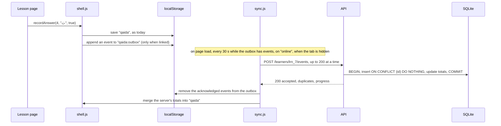

# 6. Progress sync

**Part of** [[docs/architecture/README|Architecture]] · decided in
[[docs/architecture/decisions/0006-progress-event-log|ADR-0006]] · stored in
[[docs/architecture/04-data-model|Data model]] · the seam is `shell.js` ([[docs/architecture/02-frontend|Frontend]])

**In one paragraph.** Nothing about a lesson changes. The device keeps saving progress to `localStorage` exactly as it
does today. When an adult has signed in and linked the device to a learner, each change is **also** written to a small
outbox as an event ("answered بَ right", "saw ا", "finished lesson 4"). `sync.js` sends the outbox when it can. The server
keeps every event once, adds them up, and sends the totals back. A phone and a laptop that practised offline end up with
the same totals, whatever order their events arrive in.

## Today

`shell.js` holds one object in `localStorage['qaida']`. Only these functions change progress:

| Function | What changes | Event it will also write |
|---|---|---|
| `recordAnswer(n, id, right)` | right / wrong / streak for one item | `answer` with `correct` |
| `markSeen(n, glyph)` | adds a letter (or verse) to the lesson's seen list | `seen` |
| `setDone(n, done)` | the lesson's done flag | `done` or `undone` |
| `clearLesson(n)`, `clearDrill(n)` | wipes a lesson's record | `reset` |

Four functions, one file. That narrow seam is the reason sync can be added without touching a single lesson page.

## The flow

## The rules that make it correct

1. **Every event has an id made on the device** (`crypto.randomUUID()`). The server inserts with
   `ON CONFLICT (id) DO NOTHING`, so sending the same batch twice (a timeout, a retry, two tabs) changes nothing. The
   network may deliver twice; the result counts once.
2. **Counts add up in any order.** Right answers, wrong answers and "seen" are sums and sets, so phone-then-laptop and
   laptop-then-phone give the same totals.
3. **A run of right answers depends on order**, so it is never added up. When events for an item arrive, the server
   works the run out again from that item's events, sorted by `(occurred_at, id)`: the number of right answers since the
   last wrong one, the same rule as `recordAnswer`. It is cheap, because one item has tens of events, not thousands.
4. **Device clocks are wrong sometimes.** `occurred_at` is kept between the account's creation and the server's time plus
   5 minutes. A clock set to 2031 can't put an answer in the future.
5. **A reset wins over what came before it.** Totals for a lesson only count events after its latest `reset`.
6. **Once linked, the server is the source of truth.** The device keeps working offline and catches up later. On a
   new device, the totals come down from the server; nothing has to be redone.

## Two devices, both offline

Phone and laptop each answer تَ for the same learner, then come online in either order:

| | Phone (10:00) | Laptop (10:05) | Server totals after both, either order |
|---|---|---|---|
| Answers | right, right | wrong, right | right 3, wrong 1 |
| Run of right answers | | | 1 (sorted by time: right, right, **wrong**, right) |

A "copy the whole object, last write wins" approach would have kept one device's two answers and lost the other's.

## The first link: bringing old progress along

A learner may have weeks of progress on a device from before any account existed. That history has no events, only
totals. On the first link, `sync.js` sends one **baseline** event per item, `{"right":12,"wrong":3,"streak":2}`, plus
`seen` and `done` events for the rest. The server starts that item's totals from the baseline and adds every later
event on top. If the learner already has history on the server (a second device being linked), the two baselines are
merged by taking the larger of each number. That can under-count when both devices had practised before they were
linked, but it never invents progress a learner didn't make. Then the device takes the server's totals.

## When things go wrong

| What happens | What sync does | What the student sees |
|---|---|---|
| Offline | Events wait in the outbox (at most 5,000; the oldest `seen` events drop first, never answers) | Nothing. Lessons work as always |
| The server is down or slow | Waits 30 s, then 1, 2, 5 minutes between tries | Nothing |
| 401: signed out elsewhere | Stops sending, keeps the outbox | A quiet line on the Qaida home: "Sign in again to keep saving to your account" |
| 404: the learner was deleted | Unlinks the device, keeps local progress | The same line, with "This profile was removed" |
| 422: one event is invalid | Drops that one event, logs it, sends the rest | Nothing |
| Storage full or refused | Sync switches off for the visit | Nothing; lessons work as in a private window today |

## What is sent, and when

Nothing at all until an **adult signs in and links this device to a learner**. Then only the events above: a lesson
number, an item id, right or wrong, and a time. Never a recording, never what the student typed, never which page
they looked at. A device can be unlinked in one tap, and that stops all sending.
([[docs/architecture/07-security-and-privacy|Security and privacy]])

## Files

| File | Change | Phase |
|---|---|---|
| `site/qaida/shell.js` | The four functions also append to the outbox when linked; `read()` checks the outbox like everything else it reads | E |
| `site/qaida/sync.js` | New: flush, back-off, merge, link and unlink | E |
| `site/qaida/home.js` | One line: saved to account, or why not | E |
| `server/modules/progress/` | `routes.js`, `service.js`, `repo.js`, `project.js` (the totals and the run of right answers) | E |
| `tools/qaida-sync-check.js` | New: duplicates, any-order delivery, the run of right answers, baselines, clock clamping | E |

All 25 existing check scripts must still pass unchanged. That is the proof that sync added to the Qaida without
changing how any lesson behaves.
