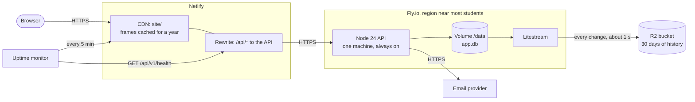
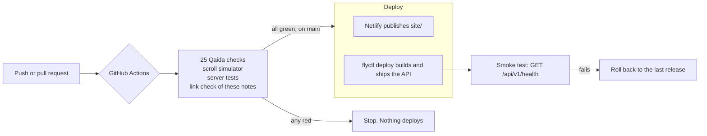

# 8. Deployment and operations

**Part of** [[docs/architecture/README|Architecture]] · decided in [[docs/architecture/decisions/0009-hosting|ADR-0009]] ·
launch steps in [[WEBSITE-BUILD]] §7, phase 7

**In one paragraph.** The pages go to Netlify's CDN, as `netlify.toml` already sets up. The API runs as one small
machine on Fly.io, with the SQLite file on a disk that survives restarts, and Litestream copying every change to a
backup bucket within about a second. Netlify forwards `/api/*` to it, so the browser only ever sees one site. GitHub
Actions runs every check on every push and does the deploying, so nothing has to be deployed from this PC.

## Environments

| Environment | Pages | API | Database | Mail |
|---|---|---|---|---|
| **Local** | `node serve.js` → `localhost:8777/site/` | `node server/main.js --dev` → pages and API together | a file in `server/data/` (ignored by git) | printed to the terminal |
| **CI** | not served | started by the tests on a free port | in memory, new for every test file | captured by the tests |
| **Preview** | a Netlify deploy preview per pull request | the production API is **not** used by previews; account features are switched off there | none | none |
| **Production** | Netlify | Fly.io, one machine | SQLite on a Fly volume, streamed to R2 | the email provider |

## Production layout



## Configuration as code

The pages' headers (security, caching, `noindex`) already live in `site/_headers`, which `serve.js` also reads
([[docs/architecture/07-security-and-privacy#Headers|Headers]]). What `netlify.toml` gains is the rewrite:

```toml
[[redirects]]
  from = "/api/*"
  to = "https://alif-to-ayah-api.fly.dev/api/:splat"
  status = 200
  force = true
```

`Strict-Transport-Security` is added to `site/_headers` once the domain serves HTTPS.

`server/Dockerfile` is short because there is no `npm install`. A sketch; phase G pins the versions. Node carries its
own certificate list, but Litestream doesn't, so the slim image needs `ca-certificates` to reach the bucket over HTTPS:

```dockerfile
FROM node:24-slim
RUN apt-get update && apt-get install -y --no-install-recommends ca-certificates && rm -rf /var/lib/apt/lists/*
WORKDIR /app
COPY server/ ./server/
COPY --from=litestream/litestream:0.3 /usr/local/bin/litestream /usr/local/bin/litestream
COPY server/litestream.yml /etc/litestream.yml
ENV NODE_ENV=production PORT=8080 DATABASE_PATH=/data/app.db
CMD ["litestream", "replicate", "-exec", "node server/main.js"]
```

`fly.toml`, the parts that matter: one machine, never stopped for being idle, the volume mounted at `/data`, and a health
check on `/api/v1/health`. `min_machines_running = 1` and **no** scaling to two, because SQLite has one writer
([[docs/architecture/decisions/0005-sqlite|ADR-0005]]). The exact file is written in phase G, against the current Fly
documentation.

## CI/CD



The workflow, `.github/workflows/ci.yml` (phase A writes the checks part, phase G the deploy part):

```yaml
name: ci
on: [push, pull_request]
jobs:
  check:
    runs-on: ubuntu-latest
    steps:
      - uses: actions/checkout@v4
      - uses: actions/setup-node@v4
        with: { node-version: 24 }
      - run: node tools/check-all.js        # every tools/*-check.js and tools/scroll-sim/checks.js
      - run: node --test server/test/        # from phase B
  deploy-api:
    needs: check
    if: github.ref == 'refs/heads/main'
    runs-on: ubuntu-latest
    steps:
      - uses: actions/checkout@v4
      - uses: superfly/flyctl-actions/setup-flyctl@master
      - run: flyctl deploy --remote-only
        env: { FLY_API_TOKEN: "${{ secrets.FLY_API_TOKEN }}" }
```

Netlify deploys the pages by itself when `main` changes, once the repository is connected.

## Backups and restore

- Litestream copies the database's write-ahead log to an R2 bucket continuously, and keeps **30 days** of history.
- **A backup no one has restored is a hope, not a backup.** Before launch, and then every three months: restore the
  latest copy to a scratch machine with `litestream restore`, start the API on it, and check a known account's
  progress. Write the date in this note.

| Restore drill | Result |
|---|---|
| (none yet) | |

## Watching it

| What | How |
|---|---|
| Is it up? | An outside uptime monitor calls the home page and `/api/v1/health` every 5 minutes and emails the teacher after two failures |
| What happened? | One JSON log line per request (request id, route, status, milliseconds), and every error with its stack, read with `fly logs` |
| Is it healthy? | `/health` runs `SELECT 1` against the database and reports the app's version |
| Visitors | Nothing by default. If wanted, a cookie-free counter (roadmap, "later ideas") |

## When something breaks

| Problem | Do this |
|---|---|
| The API is down | `fly status`, then `fly logs`. If it's stuck, `fly machine restart`. The Qaida keeps working meanwhile: sync just waits |
| A deploy broke it | `fly releases`, then deploy the last good image: `fly deploy --image <previous>`. For the pages, "Publish deploy" on an older deploy in Netlify |
| The database is damaged or wrongly changed | Stop the machine, `litestream restore -timestamp <before the problem>` onto the volume, start it |
| A secret leaked | Make a new one at the provider, put it in Fly secrets and GitHub secrets, redeploy, revoke the old one |
| Spam floods the inbox | Tighten the enquiry rate limit in config and redeploy; the honeypot already drops most bots |

## What it costs

Prices change, so check each provider's page before signing up. At launch size, roughly:

| Item | About |
|---|---|
| Netlify (pages, CDN) | Free tier |
| Fly.io (one small machine and a 1 GB volume) | A few dollars a month |
| Cloudflare R2 (backups) | Free tier at this size |
| Email provider | Free tier at this volume |
| Domain | About $10–15 a year |

## Before the first deploy

1. **The PC is cleaned** ([[WEBSITE-BUILD]] §0). Until then, no provider account tokens or API keys on this machine.
2. A domain is chosen (the site name is still open), with SPF, DKIM and DMARC for the sending address.
3. The restore drill has passed once.
4. The privacy page is live ([[docs/architecture/07-security-and-privacy|Security and privacy]]).
