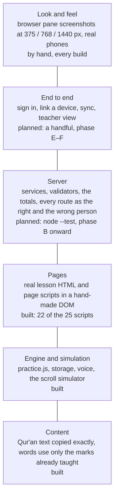

# 9. Testing

**Part of** [[docs/architecture/README|Architecture]] · the house pattern is in every `tools/*-check.js` header ·
gotchas found by testing are in [[docs/architecture/03-backend#Gotchas, written down before they bite|Backend]]

**In one paragraph.** The project already tests more than most websites do: 25 check scripts run the **real** lesson
code against the **real** lesson HTML in a small hand-made DOM, with plain `node` and no browser, and a scroll simulator
throws 600 random wheel gestures at the landing page's code. The backend keeps the same habits: Node's own test runner,
a real HTTP server, a real (in-memory) SQLite, and no mocking library.

## The layers

The bottom of the pile is the most important here: **content checks**. A wrong vowel in the Qur'an is worse than any
crash, so the copied words carry hashes that the checks recompute, and a word may only use marks the student has met.

## What runs today

Each is `node tools/<name>.js`, and each prints what it checked and exits non-zero on any failure.

| Script | Covers |
|---|---|
| `qaida-check.js` | The practice engine and its storage (Lesson 2's drill rules, caps, damaged-storage recovery) |
| `qaida-page-check.js` | Lesson 2's page |
| `qaida-lesson3-check.js` | Lesson 3, letter shapes |
| `qaida-marks-check.js` | Lesson 4, the mark page |
| `qaida-lesson5-check.js` … `qaida-lesson15-check.js` | Lessons 5–15, one each (11 scripts) |
| `qaida-rules-check.js` | Lesson 16, the rule page and its data |
| `qaida-lesson17-check.js` … `qaida-lesson22-check.js` | Lessons 17–22, each with its kit and words (6 scripts) |
| `qaida-lesson23-check.js` | Lesson 23, the verse page, the copied verses and their hashes |
| `qaida-voice-check.js` | Say it and listen back, with a fake IndexedDB, MediaRecorder and microphone |
| `qaida-words-check.js` | Every spelling and exercise word uses real letters and only marks already taught |
| `scroll-sim/checks.js` | The landing page's wheel glide and auto-finish: 600 random gestures must end where the browser's own scrolling would |

The **hash fences** in the lesson checks prove that a new lesson left the earlier ones byte-for-byte unchanged.

## What gets added

| Phase | Addition |
|---|---|
| A | `tools/check-all.js`: runs every check above, prints one summary line each, exits non-zero if any failed. One command for you, one line for CI |
| A | A link check over these notes, so the graph never has a dead link |
| B | `server/test/`: `node --test` starts a real server on a free port with an in-memory database per test file. Helpers make accounts, learners and sessions |
| B | A check that `server/package.json` has no dependencies, and that no template string reaches `prepare(` |
| D | Every route called **as the wrong person**: not signed in (401), another family (404), a teacher with no enrolment (404) |
| E | `tools/qaida-sync-check.js`: duplicates count once, any delivery order gives the same totals, the run of right answers, baselines, clock clamping, a full outbox |
| E | All 25 existing checks still pass with sync added: the proof that no lesson changed |
| E | A check that no item id released in a lesson file ever disappears ([[docs/architecture/04-data-model#Changing the schema|why]]) |

Coverage of the server's services is measured with `node --test --experimental-test-coverage`. The aim is 80% of lines,
and every rule in [[docs/architecture/07-security-and-privacy|Security and privacy]] has at least one test.

## Done means

A change is done when:

1. Every check passes (`node tools/check-all.js`, once phase A adds it).
2. Anything a person sees has been looked at in the browser pane, at 375 px and at desktop size, in both themes.
3. The notes say what changed: the lesson's build record, or the roadmap and the board here.
4. The user has signed it off ([[CLAUDE]]: one phase at a time).
