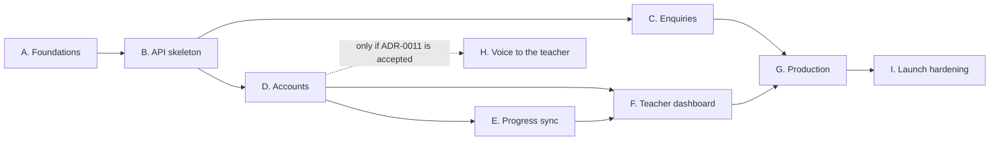

# 10. Roadmap

**Part of** [[docs/architecture/README|Architecture]] · runs beside the Qaida's own steps in [[QAIDA-BUILD]] and the
landing page's phases in [[WEBSITE-BUILD]]

**In one paragraph.** The backend is built in lettered phases, so they never get mixed up with the landing page's
numbered phases or the Qaida's steps. Each phase leaves the site working, ends with something you can see or run, and
waits for your sign-off before the next one starts. The Qaida's remaining lessons (24–29) are a separate track; the two
can take turns, in whatever order you choose.

## Order

Enquiries come before accounts because the landing page already has a contact form with nowhere to send, and it is the
smallest feature that proves the whole stack, page to database to email.

## The phases

| Phase | What gets built | Done when | Skills | Status |
|---|---|---|---|---|
| **A. Foundations** | `package.json` with scripts and no dependencies; `tools/check-all.js`; GitHub Actions running every check on every push; a root `README.md`; a tidy repo root (each file moved only with your OK) | `node tools/check-all.js` runs all 26 suites green, and the same run is green on GitHub | `agent-skills:ci-cd-and-automation`, `agent-skills:git-workflow-and-versioning` | Next, waiting for your yes. The README is done |
| **B. API skeleton** | `server/`: config, router, pipeline, problem+json, logging, `database.js`, migration 0001, `/api/v1/health`, clean shutdown, `--dev` serving the pages too, the test harness | `node server/main.js --dev` serves the site and `/api/v1/health` replies `{status:"ok", db:"ok"}`; server tests green in CI | `agent-skills:api-and-interface-design`, `agent-skills:test-driven-development` | Designed |
| **C. Enquiries** | The contact page (decided in [[WEBSITE-BUILD]] §7, phase 5), `POST /enquiries`, honeypot, rate limit, the email alert (printed to the terminal locally) | Sending the form saves a row and the alert appears; spam and bad input are refused with clear messages | `agent-skills:security-and-hardening`, `ui-ux-pro-max` | Designed |
| **D. Accounts** | Sign-in links, sessions, `/me`, learners, the account pages, download my data, delete my account | Sign in from a link, add a learner, download the JSON, delete the account, and a test proves no row is left | `agent-skills:security-and-hardening`, `agent-skills:test-driven-development` | Designed |
| **E. Progress sync** | The outbox in `shell.js`, `sync.js`, the events endpoint, the totals, the first-link baseline, linking a device from the Qaida home | Practise offline on one device, open another, and the totals match; the 25 checks pass unchanged; the sync check passes | `agent-skills:test-driven-development`, `agent-skills:incremental-implementation` | Designed |
| **F. Teacher dashboard** | Invite codes, enrolments, the student list, one student's lessons and struggling items, the enquiry inbox | After a student practises Lesson 4, the teacher sees which letters they miss | `agent-skills:frontend-ui-engineering`, `ui-ux-pro-max`, `taste-skill:minimalist-skill` | Designed |
| **G. Production** | The Fly app and volume, Litestream to R2, the Netlify rewrite and headers, the email provider and domain records, the uptime monitor, the privacy page, a restore drill | The health check is green from outside, a restore has been rehearsed, and the privacy page is live | `agent-skills:shipping-and-launch`, `agent-skills:observability-and-instrumentation` | Waits for a clean PC and a domain |
| **H. Voice to the teacher** | Only if [[docs/architecture/decisions/0011-voice-to-teacher-gated|ADR-0011]] is accepted: "Send to my teacher" for enrolled learners, under its conditions | Its conditions are each tested | `agent-skills:security-and-hardening` | **Blocked on your decision** |
| **I. Launch hardening** | Remove the tryout panels, set the chosen options, delete the `noindex` header, accessibility and speed audits, real phones. Overlaps [[WEBSITE-BUILD]] §7, phase 7 | The audits are clean and the launch checklist is done | `web-design-guidelines`, `agent-skills:webperf`, `agent-skills:ship` | Partly done: WebP frames, title and description, and on 2026-10-08 the CSP and other headers (`site/_headers`) and self-hosted fonts |

## Decisions waiting for you

| Question | Recommended | Record |
|---|---|---|
| Is this plan the right shape: local-first, accounts optional, a small API for enquiries, sync and the teacher? | Yes | [[docs/architecture/decisions/0003-local-first|ADR-0003]] |
| Node with no dependencies, and SQLite | Yes | [[docs/architecture/decisions/0004-node-zero-dependency-api|ADR-0004]], [[docs/architecture/decisions/0005-sqlite|ADR-0005]] |
| Sign in by emailed link, not password | Yes | [[docs/architecture/decisions/0007-email-link-sign-in|ADR-0007]] |
| Hosting on Netlify and Fly.io, a few dollars a month | Yes, or a small VPS if you'd rather run one machine yourself | [[docs/architecture/decisions/0009-hosting|ADR-0009]] |
| Should a student's recording ever reach the teacher? | Not for launch. Decide after the one-to-one lessons are running | [[docs/architecture/decisions/0011-voice-to-teacher-gated|ADR-0011]] |
| Which email provider, and the domain | After the site name is chosen | [[docs/architecture/08-deployment-and-operations|operations]] |
| How long to keep enquiries | 12 months after closing | [[docs/architecture/04-data-model#How long data is kept|retention]] |

## Later ideas, not planned yet

- **An installable Qaida.** A service worker that keeps the lessons on the device, so the Qaida opens with no connection
  at all and can be added to a phone's home screen. It fits the local-first rule exactly.
- **Passkeys** as a second way to sign in, once accounts exist.
- **Booking** one-to-one lessons from the site, probably by linking to an existing calendar service rather than building one.
- **A shared whiteboard** for live lessons (mentioned in [[WEBSITE-BUILD]] §7 as coming to the site). It needs a live
  connection (WebSocket) and is the largest idea here.
- **A cookie-free visitor counter**, if numbers are ever wanted.
